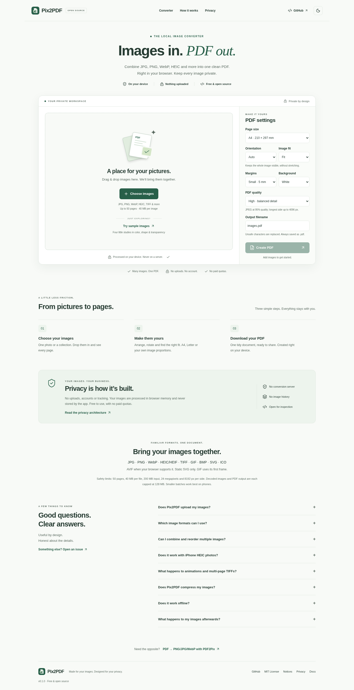

# Pix2PDF

**Turn images into PDFs. Keep them private.**

A free, open-source image-to-PDF converter that runs entirely in your browser. Combine JPG, PNG, WebP, HEIC, TIFF and other supported formats into one PDF without uploading your images.

**Version 0.1.0** · [Project URL](https://lakshminarayanan2003.github.io/image-to-pdf/) · [Source](https://github.com/LakshmiNarayanan2003/image-to-pdf) · [Report an issue](https://github.com/LakshmiNarayanan2003/image-to-pdf/issues)

The project URL is the configured GitHub Pages destination. Publication and observed test results are recorded separately in [verification](docs/VERIFICATION.md).



[Dark theme](docs/images/desktop-dark.png) · [Workspace](docs/images/workspace-light.png) · [Mobile dark](docs/images/mobile-dark.png) · [PDF ready](docs/images/success.png)

## What you can do

- Select or drop one image or a mixed batch; preview dimensions, format, size and orientation.
- Arrange PDF pages with desktop dragging, move buttons, or **Alt + ↑ / ↓** on a focused handle.
- Rotate left/right, remove pages, add images and clear the session.
- Choose Match image, A4, Letter, Legal, A3 or A5; automatic, portrait or landscape orientation.
- Fit, fill/crop or retain 96-DPI original size; set 0/5/10/20 mm margins and white/black backgrounds.
- Choose Standard, High or Maximum quality, name the PDF, and download it again.
- Convert locally with progress, cancellation, per-file errors and recovery. TIFF pages become individual PDF pages.
- Use light/dark themes, keyboard controls and a responsive workspace without an account or paid quota.
- Try four original generated sample images using the exact production pipeline.

## Formats, honestly

| Input                        | v0.1.0 behavior                                                                                                                                                      |
| ---------------------------- | -------------------------------------------------------------------------------------------------------------------------------------------------------------------- |
| JPEG / JPG / JFIF            | Native decode with EXIF orientation, including mirrored orientations. Eligible JPEGs embed without recompression at Maximum.                                         |
| PNG                          | Native decode. Transparency composites over the chosen page background.                                                                                              |
| WebP                         | Native decode when available; default still frame for animated files.                                                                                                |
| GIF                          | Bundled local decoder; **first frame only**, one page.                                                                                                               |
| BMP                          | Native decoder; common uncompressed RGB tested.                                                                                                                      |
| SVG                          | Strict static shape/text subset; locally rasterized. Scripts, CSS, external images, entities and active content rejected.                                            |
| AVIF                         | Native decoder, browser/codec dependent; actual decoding failure is reported.                                                                                        |
| HEIC / HEIF                  | Lazy local libheif/HEVC decoder. Primary image only, converted to 8-bit RGBA/PNG; no burst, depth map or HDR preservation.                                           |
| TIFF / TIF                   | Local decoder, each supported TIFF directory becomes a page. Standard RGB/grayscale; uncompressed, LZW and deflate fixtures tested. Some TIFF variants are rejected. |
| ICO                          | Native decoder chooses a bitmap; PNG-backed ICO tested.                                                                                                              |
| RAW camera formats / JPEG XL | Not supported. Export a JPEG or PNG first.                                                                                                                           |

[Format details and limitations](docs/FORMAT_SUPPORT.md). There is no claim to support every image format. SVG/PDF output is raster-based, without editable vectors, OCR or preservation of original metadata/color profiles.

## Development

Node **24.19.0 LTS** and npm. No environment variables, credentials, backend or API keys are required for the application.

```sh
npm ci
npm run dev
```

Vite serves the repository subpath `/image-to-pdf/`. Use the path printed by the dev server. Do not open `index.html` directly from disk.

```sh
npm run build
npm run preview
```

## Verification

```sh
npx playwright install --with-deps chromium firefox webkit
npm run verify
```

`verify` runs types, ESLint, formatting, unit/component tests, production build, static/privacy/license checks, documentation links, dependency audit and all browser tests. `npm run check` runs the deterministic checks without browser/audit prerequisites. See [testing](docs/TESTING.md) and the [observed verification record](docs/VERIFICATION.md) for exact results and environment-specific commands.

Other scripts: `npm run typecheck`, `npm run lint`, `npm run lint:fix`, `npm run format`, `npm run format:check`, `npm test`, `npm run test:e2e`, `npm run fixtures`, `npm run screenshots`.

## Privacy architecture

1. The browser reads selected `File` objects in memory; signature checks precede decoding.
2. Native browser decoders or a local worker normalize pixels. Previews are bounded to 360 px.
3. pdf-lib builds the PDF sequentially in memory. No input URL is passed to a server.
4. A local Blob/Object URL provides the download. Temporary URLs, workers and canvases are released; clear or refresh ends the image session.

No uploads, conversion server, analytics, accounts, cookies, document storage, remote fonts, runtime CDN or service worker. Theme preference is session-only. Lazy application/decoder assets are same-origin GETs; the sample button downloads only public bundled samples. User files never use that fetch path.

After needed bundles have loaded, conversion works without a connection. First use of a decoder may still need its static bundle, so this is not an offline-startup/PWA guarantee.

Static hosting still sees ordinary asset connections. Browser extensions, operating-system swap, browser vulnerabilities and a compromised deployed build lie outside application guarantees. JavaScript cannot securely erase browser memory. Downloaded PDFs persist because the user chose to save them. [Privacy](PRIVACY.md) · [Security](SECURITY.md).

## Architecture and fidelity

React + strict TypeScript + Vite, system fonts and Lucide icons. Local CSS follows the design language of [PDF2Pix](https://github.com/LakshmiNarayanan2003/pdf-to-image), this tool’s reverse companion.

- `src/lib/image/`: signature/dimension checks, native normalization, EXIF, static SVG validation, worker decoding and thumbnails.
- `src/lib/pdf/`: physical page layout, clipping, rotation, quality and PDF construction.
- `src/hooks/useConverter.ts`: session lifetime, input limits, sequential preparation, progress and cancellation.
- `src/components/`: accessible workspace, settings, results and product information.
- `scripts/`: generated artwork/fixtures, screenshots, licenses and static/documentation checks.

Standard uses JPEG at 85%, capped at 2400 px on the longest side. High uses JPEG at 95%, capped at 4096 px. Maximum keeps decoded resolution and PNG encoding, or directly embeds eligible RGB JPEG scan data after metadata removal. Browser color conversion and decoder precision still apply. Keep originals for archival work. [Architecture](docs/ARCHITECTURE.md) · [Decisions](docs/DECISIONS.md).

## Resource limits

These protect browser memory; they are not paid quotas:

| Resource                       | Limit                                         |
| ------------------------------ | --------------------------------------------- |
| Pages                          | 50, including expanded TIFF pages             |
| Input file                     | 40 MiB                                        |
| Total original input           | 200 MiB, each multi-page source counted once  |
| Decoded image                  | 24 million pixels; 8192 px per side           |
| Retained normalized image data | 128 MiB, plus small previews/runtime overhead |
| Encoded PDF output             | 128 MiB                                       |
| SVG source / elements          | 2 MiB / 10,000 elements                       |
| Worker decoding                | 45 seconds per source file                    |

Labels use MB as shorthand for MiB. Peak RAM also includes decoded pixels, WASM, canvas and PDF copies; these limits cannot guarantee a fixed heap size. Smaller batches are recommended on phones. If a tab runs out of memory, close other tabs or resize the source images. [Troubleshooting](docs/TESTING.md).

## Samples and screenshots

All application samples and test artwork are generated by this project; none is a borrowed photograph. `sample-photo.jpg` is a generated landscape illustration saved as JPEG. `npm run fixtures` recreates samples and most edge cases from local code. The original HEIC fixture is committed; optional regeneration uses [the Python script](scripts/generate-heic-fixture.py) with pinned Pillow/pillow-heif versions. No external websites are accessed by tests for fixtures.

`npm run screenshots` captures the actual production app and starts a local preview if needed. [Fixture and screenshot workflow](docs/TESTING.md).

## GitHub Pages

The default branch and deployment target are **master**. In **Settings → Pages → Build and deployment**, select **GitHub Actions**. Thereafter a push to `master` runs the deployment workflow automatically. It publishes the exact default-path artifact only after the full CI gate passes; pull requests do not deploy.

The Vite default base is `/image-to-pdf/`. `VITE_BASE_PATH=/pix2pdf/` supports a different host/subpath; it does not rename the actual repository or canonical SEO URL. [Deployment guide](docs/DEPLOYMENT.md).

## Browser support and accessibility

Current Chrome/Edge, Firefox and Safari are the targets. Playwright Chromium, Firefox and WebKit exercise the same production build, actual downloads, independent PDF rendering, keyboard controls, desktop dragging, 390/320 px mobile layouts, dark mode, axe and network/storage checks. Format availability is conditional on real native decoding. WebKit may replace spaces in suggested download names with underscores; the PDF title retains the chosen name.

Playwright WebKit is not a physical iPhone test; Chromium is not a separately tested Edge installation. Automated axe checks are not WCAG certification. Screen-reader experience, real mobile download dialogs, print color and unusual photo collections still benefit from human review.

## Open source

MIT © 2026 Lakshmi Narayanan Sridharan for application code. The optional HEIC decoder includes LGPL-3.0 libraries; their notices, corresponding source archives and replacement instructions are distributed with the static site. [License](LICENSE) · [Third-party notices](THIRD_PARTY_NOTICES.md) · [Contributing](CONTRIBUTING.md) · [Changelog](CHANGELOG.md) · [Roadmap](ROADMAP.md) · [Code of conduct](CODE_OF_CONDUCT.md).

Need the opposite? [PDF → PNG/JPG/WebP with PDF2Pix](https://lakshminarayanan2003.github.io/pdf-to-image/).
