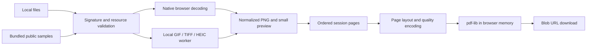

# Architecture

Pix2PDF is a static React/TypeScript application built by Vite. The hosting server serves files; it never receives conversion inputs. There is no application backend, database, service worker or account system.

## Ownership and state

`useConverter` owns the ordered `ImageItem` list, PDF settings, errors, progress, cancellation controller and downloadable output. Mutable refs provide current ownership during asynchronous operations; React state renders that session. An input source ID lets expanded TIFF pages share one original-file byte count. Each retained page has a canonical oriented PNG, thumbnail URL, dimensions, format and rotation; eligible JPEGs also retain stripped original JPEG bytes for Maximum quality.

Ingestion is sequential. A failed file adds an actionable error and does not discard successful files. Preparation creates temporary resources, validates the full result against session limits, then transfers ownership to the session. Failed or canceled preparations revoke temporary URLs. Mutation invalidates the old result URL. Remove, clear and unmount revoke owned previews/results and abort active work. The app persists neither files nor theme preference.

## Image pipeline

`image/detect.ts` sniffs bytes before decode and rejects misleading/non-image MIME values, camera RAW extensions and excessive source dimensions where headers expose them. `image/svg.ts` parses an inert document and permits a deliberately small static subset. Accepted SVG becomes an image source, never live application markup.

Native decoders handle JPEG, PNG, WebP, BMP, ICO, AVIF and validated SVG. JPEG orientation is applied by the browser, including mirrored EXIF values. Direct JPEG eligibility requires orientation 1, three channels and no ICC profile; metadata segments are removed before embedding. Other files become oriented PNG pixels.

GIF, TIFF and HEIC run in a disposable module worker. The HEIC WASM, TIFF and GIF modules load on demand from the same origin. TIFF headers/directories receive bounds checks before decoder allocation; supported directories become separate pages. Worker timeout and cancellation terminate the worker. Native decoding and PDF-library calls cannot all be interrupted mid-operation; cancellation is observed at the next application checkpoint.

## PDF geometry and fidelity

`pdf/layout.ts` is pure geometry in PDF points. Fixed pages use millimeters/inches converted at 72 points/inch. Match image uses 96 source pixels/inch, with a maximum content side of 20 inches, plus margins. Rotation affects layout before automatic orientation. Fit contains; Fill crops symmetrically; Original size uses 96 DPI and clips overflow to the content rectangle.

`pdf/build.ts` adds one image per page in session order, draws the selected page background, clips to the margin rectangle and applies rotation. Maximum embeds PNG or eligible JPEG. Standard/High rasterize over the background into JPEG at quality .85/.95, with 2400/4096-pixel caps. PNG alpha remains composited against the page background at Maximum. Metadata identifies Pix2PDF and uses a sanitized output title.

The PDF library is lazy-loaded. Image streams are flushed sequentially, but the final document must still reside in memory for download. Bounds reduce risk, not guarantee a peak heap allocation. See [limits and threats](../SECURITY.md).

## UI and static delivery

Semantic controls, labeled inputs, live progress/error messages, keyboard order controls, visible focus and both color themes share local CSS. No remote font or icon requests occur. Samples, workers and chunks resolve against `import.meta.env.BASE_URL`; GitHub Pages uses `/image-to-pdf/`. A restrictive CSP permits same-origin scripts/workers and WebAssembly compilation, without general JavaScript eval or inline script/style permissions.

The build generates third-party license files and ships the HEIC library notices and corresponding source archives. The deployment workflow publishes the tested artifact only after the reusable CI workflow succeeds. See [deployment](DEPLOYMENT.md), [privacy](../PRIVACY.md) and [decisions](DECISIONS.md).
